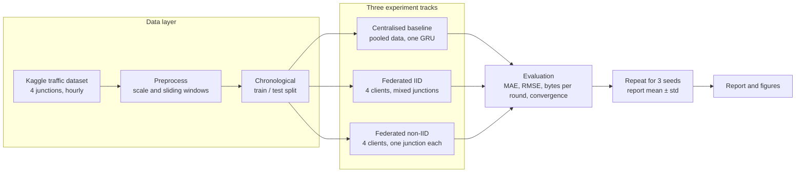
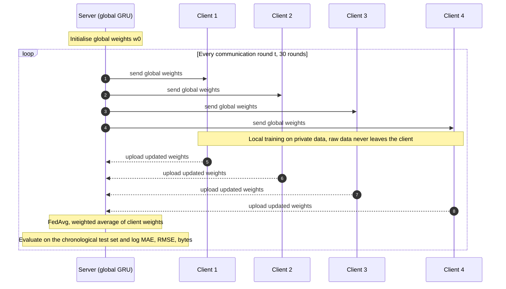
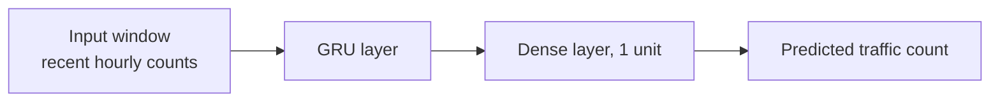

# FedTraffic: Federated Traffic-Flow Prediction with Communication-Cost Evaluation

*Train one traffic-forecasting model across four junctions without pooling their raw data, then measure in bytes what that costs.*

[](https://portal.aiori.in/aiori-3/hackathon/)
[](#1-overview)
[](#12-team)
[](https://www.python.org/)


*Figure 1: Test error per communication round for the centralised baseline, federated IID and federated non-IID runs (mean over 3 seeds).*

> **TODO before pushing:** search this file for `TODO` and resolve every hit. Figure paths such as `reports/figures/convergence_comparison.png` must match the files actually in your repo.

---

## Table of Contents

- [1. Overview](#1-overview)
- [2. Related Work](#2-related-work)
- [3. System Architecture](#3-system-architecture)
- [4. Data Flow of One Federated Round](#4-data-flow-of-one-federated-round)
- [5. Method](#5-method)
- [6. Results](#6-results)
- [7. Repository Structure](#7-repository-structure)
- [8. Quickstart](#8-quickstart)
- [9. Reproducibility](#9-reproducibility)
- [10. Scope and Limitations](#10-scope-and-limitations)
- [11. References](#11-references)
- [12. Team](#12-team)

---

## 1. Overview

Traffic forecasting normally means streaming raw readings from every roadside sensor to one central server. That is expensive in bandwidth and concentrates a lot of data in one place. **Federated learning** flips it: each site trains locally and only sends model weights to a server, which averages them (FedAvg [1]).

**FedTraffic** is a federated-learning simulator built for AIORI-3 problem statement **PS-003**. It answers three questions:

1. How close does federated training get to centralised training on hourly junction traffic?
2. What happens when each client sees a *different* junction (non-IID) instead of a representative mix (IID)?
3. How many bytes does each communication round cost?

### Headline results

| Setup | Error vs centralised baseline | Communication |
| :--- | :---: | :--- |
| Centralised (pooled data) | reference | none (all data in one place) |
| Federated, IID clients | about **3% worse** | 108,576 bytes per round |
| Federated, non-IID clients (1 junction each) | about **25% worse** | 108,576 bytes per round |

- Total communication over 30 rounds: **3,257,280 bytes (about 3.1 MiB)**.
- The non-IID split hurts most at Junction 1, where MAE rises from **4.5 to 7.7**.
- Communication cost depends only on model size, number of clients and number of rounds. It is the same for IID and non-IID, so the data split changes accuracy, not bytes.

> **TODO:** replace the "about" figures with exact mean ± std MAE/RMSE from your 3-seed table (Section 6), say which metric the 3% / 25% refer to, and state which run the 4.5 MAE comes from.

### Core design choices

- **Compact model.** A small GRU keeps every round cheap, which makes the communication numbers easy to reason about.
- **Plain FedAvg.** No compression or clustering tricks, so the baseline cost is transparent.
- **Leakage-free evaluation.** Chronological train/test split, never a random one.
- **Three seeds.** Every result is reported as mean ± std over three random seeds.

---

## 2. Related Work

| Ref | What it contributes | How FedTraffic relates |
| :---: | :--- | :--- |
| [1] | Introduces Federated Averaging (FedAvg). | Our aggregation rule. |
| [2] | FedGRU: a federated GRU for traffic-flow prediction with a secure parameter-aggregation mechanism. | Closest prior work to our model choice. |
| [3] | CTFed: cuts communication in federated traffic forecasting by clustering clients and uploading one representative update per cluster. | A natural next step once we have a plain-FedAvg cost baseline. |
| [4] | Graph-based variant of the clustering idea for GNN traffic models. | Shows why model size drives communication cost. |
| [5] | Sparse ternary compression for federated learning, motivated by non-i.i.d. client data. | Motivates our IID vs non-IID comparison and future update compression. |

Published work mostly optimises accuracy or *reduces* communication with extra machinery. FedTraffic does something narrower: a small, reproducible benchmark that puts MAE, RMSE, **bytes per round** and convergence side by side for centralised, IID and non-IID setups, across three seeds.

---

## 3. System Architecture



---

## 4. Data Flow of One Federated Round

Raw traffic data stays on each client. Only model weights cross the network.



---

## 5. Method

### 5.1 Data and preprocessing

- **Dataset:** public Kaggle traffic dataset with hourly vehicle counts at 4 junctions. **TODO:** add dataset name and link.
- **Scaling and windows:** **TODO:** state scaler, input window length and prediction horizon.
- **Split:** chronological, with earlier timestamps for training and later ones for testing. **TODO:** add the exact ratio / cut-off date.

### 5.2 Model

A compact recurrent forecaster with **3,393 trainable parameters**.



The parameter count is consistent with a single GRU layer of 32 units on one input feature (3,360 parameters) plus a one-unit dense head (33 parameters). **TODO:** confirm this matches your code, or correct the breakdown.

One copy of the model is 3,393 × 4 bytes = 13,572 bytes (about 13.3 KiB) in float32.

### 5.3 Federated Averaging

In round $t$, the server sends the global weights $w_t$ to all $K$ clients. Each client $k$ trains on its own $n_k$ samples and returns $w_{t+1}^{k}$. The server then aggregates:

$$
w_{t+1} = \sum_{k=1}^{K} \frac{n_k}{n}\, w_{t+1}^{k}, \qquad n = \sum_{k=1}^{K} n_k
$$

**TODO:** state local epochs, batch size, optimiser, learning rate and number of rounds (30).

### 5.4 IID vs non-IID clients

| Setting | How the 4 clients are built |
| :--- | :--- |
| **IID** | Each client gets a representative mix of all four junctions. **TODO:** describe exactly how the mix is drawn. |
| **Non-IID** | Client $k$ holds **only Junction $k$'s** time series, so each client sees a different traffic pattern. |

### 5.5 Metrics

$$
\text{MAE} = \frac{1}{N}\sum_{i=1}^{N}\left|y_i-\hat{y}_i\right|, \qquad
\text{RMSE} = \sqrt{\frac{1}{N}\sum_{i=1}^{N}\left(y_i-\hat{y}_i\right)^2}
$$

### 5.6 Communication cost

Each round, every client downloads the global model and uploads its update, each $P$ parameters in float32 ($s = 4$ bytes):

$$
B_{\text{round}} = 2\,K\,P\,s, \qquad B_{\text{total}} = R \cdot B_{\text{round}}
$$

With $K = 4$ clients and $P = 3{,}393$ parameters:

| Quantity | Value |
| :--- | :--- |
| Bytes per round | 2 × 4 × 3,393 × 4 = **108,576 bytes** |
| Bytes over $R = 30$ rounds | **3,257,280 bytes**, about 3.1 MiB (3.26 MB decimal) |

These are computed from the parameter count, not measured on a real network, and they exclude protocol overhead.

---

## 6. Results

All numbers are mean ± std over 3 random seeds, evaluated on the held-out chronological test set.

| Setup | MAE | RMSE | Error vs centralised |
| :--- | :---: | :---: | :---: |
| Centralised | TODO | TODO | reference |
| Federated, IID | TODO | TODO | about +3% |
| Federated, non-IID | TODO | TODO | about +25% |

### Key observations

- **IID federated training is nearly free in accuracy.** When every client sees a representative mix, FedAvg lands within about 3% of pooled training.
- **Non-IID data is the real cost.** With one junction per client, error rises by about 25%, and Junction 1 is hit hardest (MAE 4.5 to 7.7). This matches the client-drift behaviour reported for non-i.i.d. federated learning [5].
- **Bytes do not change with the split.** Both federated runs move 108,576 bytes per round. The trade-off is therefore accuracy versus privacy and data movement, not versus bandwidth.

### Figures

| Convergence (error vs round) | Communication (cumulative bytes) |
| :---: | :---: |
|  |  |

> **TODO:** export these two plots from your notebook into `reports/figures/` (or change the paths), and optionally add a per-junction MAE table.

---

## 7. Repository Structure

> **TODO:** replace with your real tree. The layout below is a template.

```text
A3-PS003-TC008/
├── data/                  # dataset (or download instructions)
├── notebooks/             # training and analysis notebooks
├── src/                   # data prep, GRU model, FedAvg simulator, metrics
├── reports/
│   ├── figures/           # convergence and communication plots
│   └── results.csv        # per-seed metrics
├── Proposed-structure-hackathon.pdf
├── README.md
└── requirements.txt
```

---

## 8. Quickstart

> **TODO:** replace the commands with the ones that actually run your project.

```bash
git clone https://github.com/aiori-hackathon/A3-PS003-TC008.git
cd A3-PS003-TC008
pip install -r requirements.txt
```

Run the three experiments:

```bash
# centralised baseline
# TODO: command

# federated, IID clients
# TODO: command

# federated, non-IID clients (1 junction per client)
# TODO: command
```

---

## 9. Reproducibility

- **Seeds:** every experiment is repeated for 3 random seeds. **TODO:** list the seed values.
- **No temporal leakage:** training data always precedes test data in time.
- **Same model everywhere:** centralised and federated runs use the identical GRU, so differences come from the training setup, not the architecture.
- **TODO:** confirm that scaling statistics are fitted on the training split only.

---

## 10. Scope and Limitations

- **Simulation only.** All clients run in one process. There are no live cameras, no real network and no city-wide deployment.
- **Analytical communication cost.** Bytes are derived from the parameter count, not measured on the wire.
- **No formal privacy guarantee.** Keeping raw data local is not the same as differential privacy.
- **Small and single-source.** One dataset with four junctions and a compact model.
- **Plain FedAvg.** No FedProx, update compression or client clustering.

**Future work:** non-IID-aware optimisers, compressing client updates as in [5], clustering clients as in [3] and [4], more junctions, and repeating the study on an open Indian traffic sensor dataset once one is available.

---

## 11. References

[1] H. B. McMahan, E. Moore, D. Ramage, S. Hampson, and B. A. y Arcas, "Communication-efficient learning of deep networks from decentralized data," in *Proc. 20th Int. Conf. Artif. Intell. Statist. (AISTATS)*, PMLR vol. 54, 2017. [Online]. Available: https://proceedings.mlr.press/v54/mcmahan17a.html

[2] Y. Liu, J. J. Q. Yu, J. Kang, D. Niyato, and S. Zhang, "Privacy-preserving traffic flow prediction: A federated learning approach," *IEEE Internet Things J.*, 2020. **TODO:** add volume, issue and page numbers from IEEE Xplore.

[3] C. Zhang, L. Cui, S. Yu, and J. J. Q. Yu, "A communication-efficient federated learning scheme for IoT-based traffic forecasting," *IEEE Internet Things J.*, vol. 9, no. 14, pp. 11918-11931, Jul. 2022. [Online]. Available: https://ieeexplore.ieee.org/document/9634121

[4] C. Zhang, S. Zhang, S. Yu, and J. J. Q. Yu, "Graph-based traffic forecasting via communication-efficient federated learning," in *Proc. IEEE Wireless Commun. Netw. Conf. (WCNC)*, Apr. 2022, pp. 2041-2046, doi: 10.1109/WCNC51071.2022.9771883.

[5] F. Sattler, S. Wiedemann, K.-R. Müller, and W. Samek, "Robust and communication-efficient federated learning from non-i.i.d. data," *IEEE Trans. Neural Netw. Learn. Syst.*, vol. 31, no. 9, pp. 3400-3413, Sep. 2020.

[6] **TODO:** cite the Kaggle traffic dataset (title, author, URL, access date).

---

## 12. Team

**Team Tech-4-Impact** · AIORI-3 Hackathon · Team code **A3-PS003-TC008**

| Name | Role | GitHub |
| :--- | :--- | :--- |
| Sajal Gupta | TODO | [@Sajal-Gupta-wave](https://github.com/Sajal-Gupta-wave) |
| Abhinav Hari | TODO | [@Abhinav-Hari](https://github.com/Abhinav-Hari) |
| Mr. Gowtham | Mentor | [@gowthamgopal16-coder](https://github.com/gowthamgopal16-coder) |

Thanks to the AIORI-3 organisers and our mentor for the guidance.

**License:** TODO (add a `LICENSE` file, or remove this line).
