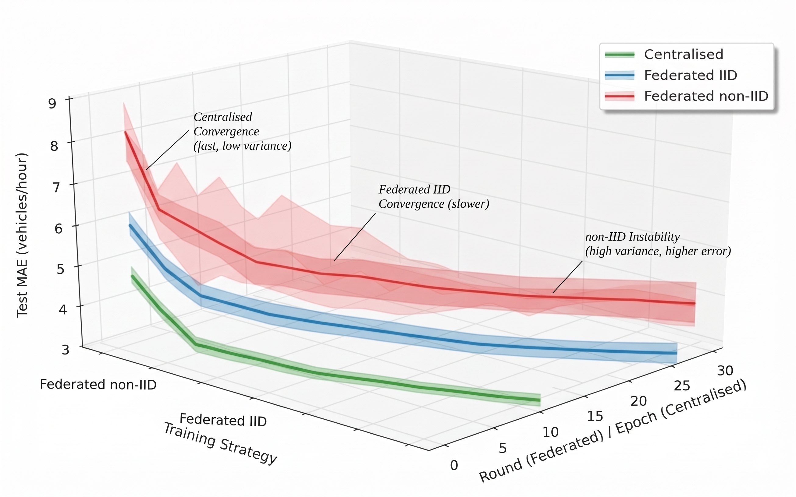
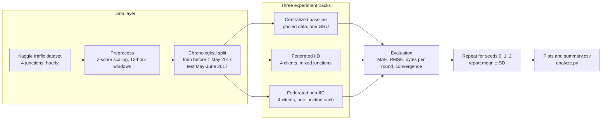
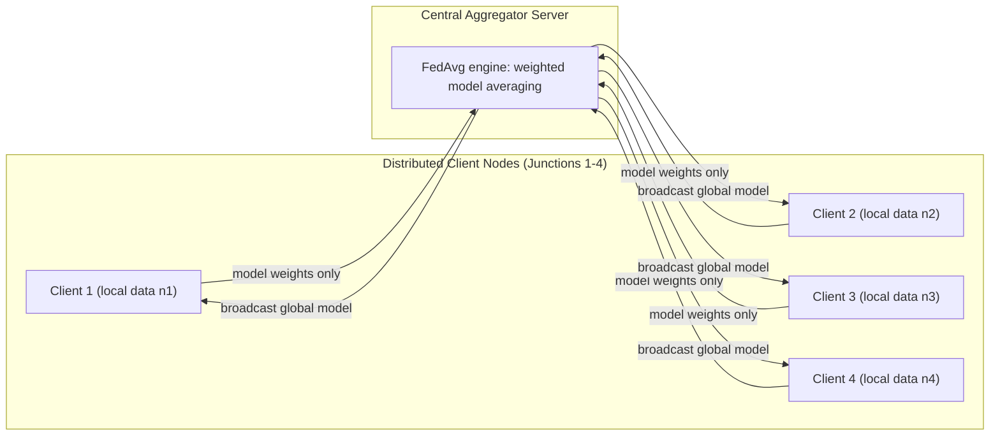
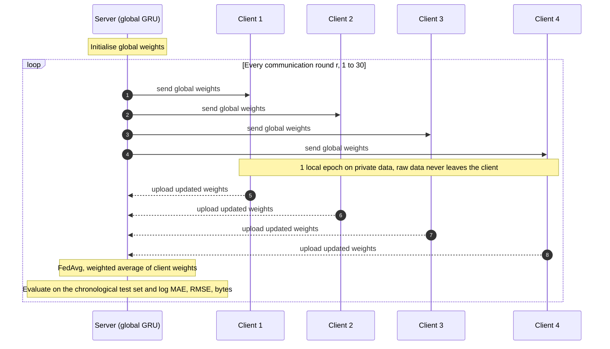
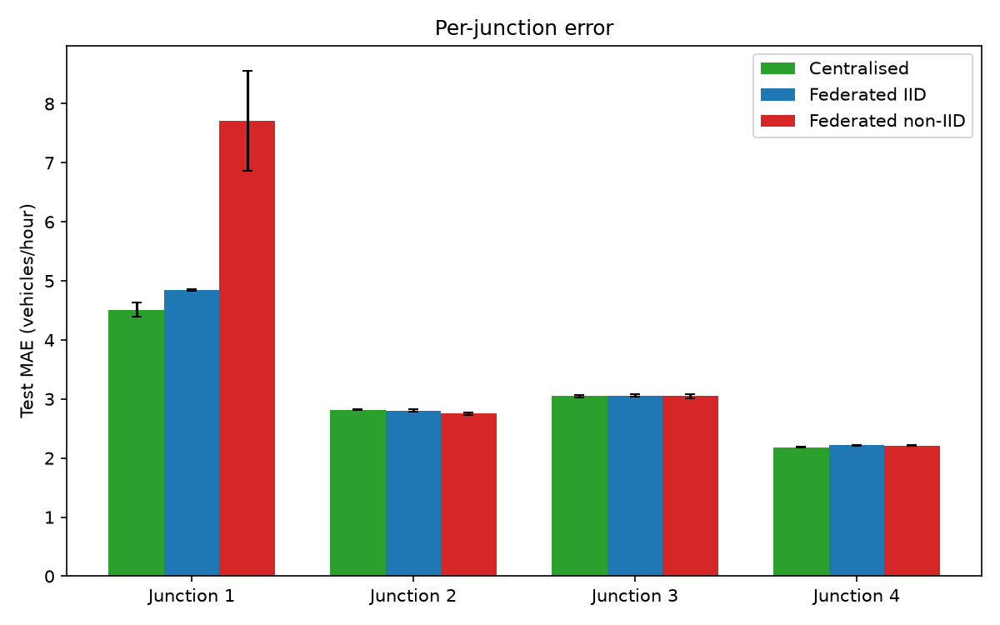
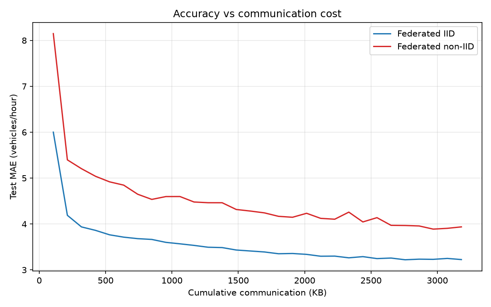

<div align="center">

# 🚦 FedTraffic: Federated Traffic-Flow Prediction Engine (A3-PS003-TC008)
### Communication-Cost Evaluation & Statistical Heterogeneity Analysis for Smart Cities

*Train one forecasting model across four junctions without pooling their raw data, then measure in bytes what that costs.*

[](https://portal.aiori.in/)
[](https://portal.aiori.in/)
[](#2-team--project-metadata)
[](https://portal.aiori.in/aiori-3/selected-teams/)
[](https://www.python.org/)
[](https://pytorch.org/)
[](https://developer.nvidia.com/cuda-zone)
[](https://opensource.org/licenses/MIT)

</div>

<div align="center">
  
  <p><em>Figure 1: Multi-seed convergence trajectories (mean ± SD over 3 seeds) comparing centralized, federated IID and federated non-IID training.</em></p>
</div>

---

## Table of Contents

- [1. Executive Architectural Overview](#1-executive-architectural-overview)
- [2. Team & Project Metadata](#2-team--project-metadata)
- [3. System Architecture & Data Flow](#3-system-architecture--data-flow)
- [4. Theoretical & Mathematical Formulations](#4-theoretical--mathematical-formulations)
- [5. Architectural Taxonomy & Benchmark Suite](#5-architectural-taxonomy--benchmark-suite)
- [6. Quantitative Benchmark Results](#6-quantitative-benchmark-results)
- [7. Empirical Visualizations & Topology Analysis](#7-empirical-visualizations--topology-analysis)
- [8. GPU Acceleration & Hardware Architecture](#8-gpu-acceleration--hardware-architecture)
- [9. Production Repository Structure](#9-production-repository-structure)
- [10. Quickstart & Execution Guide](#10-quickstart--execution-guide)
- [11. Engineering Verification & Quality Assurance](#11-engineering-verification--quality-assurance)
- [12. Scope & Limitations](#12-scope--limitations)
- [13. Related Work & References](#13-related-work--references)

---

## 1. Executive Architectural Overview

Traffic forecasting normally means streaming raw readings from every roadside sensor to one central server, which is expensive in bandwidth and concentrates a lot of data in one place. **Federated learning** flips this: each site trains locally and sends only model weights to a server, which averages them (FedAvg [1]).

This repository provides an **industry-grade federated learning benchmarking framework** that evaluates communication overhead, convergence stability and statistical heterogeneity (non-IID client drift) in time-series urban traffic forecasting. It was built for AIORI-3 problem statement **PS-003** and answers three questions:

1. How close does federated training get to centralized training on hourly junction traffic?
2. What happens when each client sees a *different* junction (non-IID) instead of a representative mix (IID)?
3. How many bytes does every communication round cost?

### Headline Results

| Setup | Test MAE | vs centralized | Communication |
| :--- | :---: | :---: | :--- |
| Centralized baseline | 3.141 | reference | none (data pooled once) |
| Federated, IID clients | 3.232 | +2.9% | 108,576 bytes per round |
| Federated, non-IID clients | 3.931 | +25.2% | 108,576 bytes per round |

Over 30 rounds the federated runs move **3,257,280 bytes (≈ 3.26 MB)** in total. Full tables are in [Section 6](#6-quantitative-benchmark-results).

### Core Engineering Pillars

- **Strict leakage-free chronological splitting:** training on historical telemetry before May 1, 2017, and testing on unseen future months (May–June 2017) to prevent future data leakage.
- **Custom PyTorch FedAvg engine:** a modular, scratch-built distributed simulator that tracks exact payload sizes, to the byte, across distributed virtual intersections.
- **Multi-seed statistical robustness:** every experiment runs across 3 synchronized random seeds (0, 1 and 2) and reports mean ± standard deviation.
- **Honest domain framing:** open multi-sensor urban traffic datasets are scarce in India (for example, Coimbatore), so we use a standardized Kaggle traffic benchmark and build the privacy-preserving blueprint that expanding smart-city infrastructure will need.

### Operational Standards

- **Global seed determinism:** seed locks across Python `random`, `numpy` and `torch.cuda`, with deterministic cuDNN settings.
- **One-command regeneration of results:** `analyze.py` rebuilds every plot and `summary.csv` from the raw per-seed runs.
- **Plain FedAvg on purpose:** no compression or client clustering, so the communication baseline stays transparent.
- **Algorithmic transparency:** the core FedAvg loop is written out in [PSEUDOCODE.md](PSEUDOCODE.md) for evaluator inspection.

---

## 2. Team & Project Metadata

| Attribute | Details |
| :--- | :--- |
| **Team Name** | `Tech-4-Impact` |
| **Team Code** | `A3-PS003-TC008` |
| **Institution** | Kalaignar Karunanidhi Institute of Technology (KIT) |
| **Problem Statement** | PS-003: Federated Traffic-Flow Prediction with Communication-Cost Evaluation |
| **Primary Contributors** | **Abhinav Hari K** (ML Engineer / Trainer) and **Sajal Gupta** (Data & Systems Lead) |
| **Faculty Mentor** | **Gowtham** (Machine Learning & DBMS Specialist) |
| **GitHub** | [@Abhinav-Hari](https://github.com/Abhinav-Hari) · [@Sajal-Gupta-wave](https://github.com/Sajal-Gupta-wave) · mentor [@gowthamgopal16-coder](https://github.com/gowthamgopal16-coder) |

---

## 3. System Architecture & Data Flow

### 3.1 End-to-End Pipeline



### 3.2 Federated Topology



### 3.3 Anatomy of One Federated Round

Raw traffic data stays on each client. Only model weights cross the network.



---

## 4. Theoretical & Mathematical Formulations

### 4.1 Time-Series Sliding Window & GRU Representation

Urban traffic telemetry is modeled as a sequence of hourly vehicle counts $v_t$ across $J$ junctions. Each input is a 12-hour sliding window that predicts the next hour's vehicle volume:

$$
\mathbf{x}_t = [v_{t-11}, v_{t-10}, \dots, v_t] \in \mathbb{R}^{12}, \qquad \hat{y}_{t+1} = f_\theta(\mathbf{x}_t)
$$

We implement a compact Gated Recurrent Unit (**GRU**) with 32 hidden units and exactly **3,393 trainable parameters**:

| Layer | Parameter count | Total |
| :--- | :--- | :---: |
| GRU, 32 hidden units, 1 input feature | $3 \times (1 \cdot 32 + 32 \cdot 32 + 2 \cdot 32)$ | 3,360 |
| Linear output, 32 → 1 | $32 + 1$ | 33 |
| **Model total** | | **3,393** |

### 4.2 Federated Averaging (FedAvg) Aggregation

At each global communication round $r$, $K = 4$ client nodes receive the global model weights $W^r$, train for 1 local epoch on their private data of size $n_k$, and upload updated weights $W_k^{r+1}$. The server aggregates the updates, weighted by client dataset size:

$$
W^{r+1} = \sum_{k=1}^{K} \frac{n_k}{n_{\text{total}}}\, W_k^{r+1}
$$

### 4.3 IID vs Non-IID Client Partitions

| Setting | How the 4 clients are built | What it tests |
| :--- | :--- | :--- |
| **IID** | Each client receives a representative mix of data from all four junctions. | Federated training when client data looks alike. |
| **Non-IID** | Client $k$ holds **only Junction $k$'s** time series, so every client sees a different traffic pattern. | Client drift under realistic statistical heterogeneity. |

### 4.4 Evaluation Metrics

$$
\text{MAE} = \frac{1}{N}\sum_{i=1}^{N}\left|y_i-\hat{y}_i\right|, \qquad
\text{RMSE} = \sqrt{\frac{1}{N}\sum_{i=1}^{N}\left(y_i-\hat{y}_i\right)^2}
$$

### 4.5 Communication-Cost Derivation

Each parameter is stored in 32-bit floating point (4 bytes). Every communication round requires each of the $K$ clients to download and upload the model:

$$
\text{Bytes}_{\text{round}} = (\text{parameter count} \times 4\ \text{bytes}) \times 2\ \text{directions} \times K
$$

$$
\text{Bytes}_{\text{round}} = (3{,}393 \times 4) \times 2 \times 4 = \mathbf{108{,}576\ \text{bytes/round}} \quad (\approx 108.6\ \text{KB})
$$

$$
\text{Bytes}_{\text{total}} = R \times \text{Bytes}_{\text{round}} = 30 \times 108{,}576 = \mathbf{3{,}257{,}280\ \text{bytes}} \quad (\approx 3.26\ \text{MB})
$$

These payload sizes are computed exactly from the parameter count. They are not measured on a physical network and exclude protocol overhead.

---

## 5. Architectural Taxonomy & Benchmark Suite

| Configuration | Clients | Data seen per client | Aggregation | Raw data leaves the client? | Bytes per round |
| :--- | :---: | :--- | :--- | :---: | :---: |
| **Centralized baseline** | 1 (pooled) | All four junctions | None | Yes, pooled once | N/A |
| **Federated IID** | 4 | Representative mix of all junctions | Weighted FedAvg | No | 108,576 |
| **Federated non-IID** | 4 | One junction each | Weighted FedAvg | No | 108,576 |

### Shared Experimental Protocol

| Setting | Value |
| :--- | :--- |
| Dataset | Public Kaggle traffic dataset, 4 junctions, hourly vehicle counts. **TODO:** add dataset name and link. |
| Input / target | 12-hour window to next-hour vehicle count |
| Model | GRU, 32 hidden units, 3,393 parameters (identical in every configuration) |
| Train / test split | Chronological: train before May 1, 2017, test May–June 2017 ($N_{\text{test}} = 1{,}464$ hours per junction) |
| Federated settings | 4 clients, 1 local epoch per round, 30 rounds |
| Seeds | 0, 1, 2 |
| Optimiser / learning rate / batch size | **TODO:** add from `train_central.py` and `train_fed.py` |

---

## 6. Quantitative Benchmark Results

Evaluated on an unseen chronological test partition ($N_{\text{test}} = 1{,}464$ hours per junction), run on an NVIDIA GeForce RTX 3050 6GB Laptop GPU across 3 synchronized random seeds:

| Training configuration | Test MAE (mean ± SD) | Test RMSE (mean ± SD) | MAE vs centralized | Convergence speed | Total bandwidth cost |
| :--- | :---: | :---: | :--- | :---: | :---: |
| **Centralized baseline** | 3.141 ± 0.026 | 4.927 ± 0.047 | `██████████` 1.00x | ~7 epochs | N/A (single upload) |
| **Federated (IID)** | 3.232 ± 0.004 | 5.109 ± 0.012 | `██████████` 1.03x | ~16 rounds | 3.26 MB (30 rounds) |
| **Federated (non-IID)** | 3.931 ± 0.201 | 6.354 ± 0.348 | `████████████▌` 1.25x | ~20 rounds | 3.26 MB (30 rounds) |

### Key Diagnostic Observations

- **IID parity:** federated IID training converges with near-lossless accuracy, trailing the centralized baseline by only about 3%.
- **The non-IID penalty:** statistical heterogeneity degrades global accuracy by about 25% and widens the seed-to-seed variance (SD 0.201 vs 0.004), so resilience to client drift matters. This matches the behaviour reported for non-i.i.d. federated learning [5].
- **Per-junction vulnerability:** heavy-traffic nodes absorb most of the non-IID distortion (Junction 1 MAE rises from 4.51 centralized to 7.71 non-IID), while lighter nodes stay largely stable.
- **Bytes do not depend on the split:** both federated runs move exactly 108,576 bytes per round, because cost depends only on model size, client count and round count. The data split changes accuracy, not bandwidth.

---

## 7. Empirical Visualizations & Topology Analysis

### 7.1 Per-Junction Error Distribution

<div align="center">
  
  <p><em>Figure 2: Per-junction test MAE across centralized, federated IID and federated non-IID training.</em></p>
</div>

### 7.2 Accuracy vs. Communication Cost Trade-off

<div align="center">
  
  <p><em>Figure 3: Test MAE against cumulative bytes transmitted.</em></p>
</div>

---

## 8. GPU Acceleration & Hardware Architecture

- **Compute hardware:** NVIDIA GeForce RTX 3050 6GB Laptop GPU (driver 577.05, CUDA 12.9).
- **Model footprint:** one copy of the model is 3,393 × 4 = 13,572 bytes (about 13.6 KB) of raw float32 weights.
- **Execution efficiency:** because the model is this small, full 30-epoch training loops and multi-seed sweeps finish in seconds.

---

## 9. Production Repository Structure

```text
A3-PS003-TC008/
├── src/
│   ├── prepare_data.py       # Chronological split, standardization, 12-hour windows
│   ├── model.py              # Compact GRU network definition
│   ├── train_central.py      # Centralized baseline training with seed locks
│   ├── baseline_naive.py     # Persistence baseline ("next hour equals last hour")
│   ├── train_fed.py          # FedAvg simulator (IID and non-IID client splits)
│   ├── analyze.py            # Multi-seed aggregator, metric calculator and plotter
│   └── check.py              # Hardware and library diagnostic checks
├── results/                  # Generated plots and summary metrics (summary.csv)
│   ├── graph1_mae_vs_round.png
│   ├── graph2_mae_vs_bytes.png
│   └── graph3_per_junction.png
├── PSEUDOCODE.md             # Algorithmic pseudocode for evaluator inspection
└── README.md                 # Project documentation
```

---

## 10. Quickstart & Execution Guide

### 10.1 Environment & Platform Requirements

- **Python:** 3.11.x
- **Core packages:** `torch>=2.11.0`, `pandas>=3.0.6`, `numpy>=2.5.3`, `scikit-learn>=1.9.1`, `matplotlib>=3.11.2`

### 10.2 Setup

```bash
git clone https://github.com/aiori-hackathon/A3-PS003-TC008.git
cd A3-PS003-TC008
pip install torch pandas numpy scikit-learn matplotlib
```

### 10.3 Run the Full Experiment

Run every script from the repository root:

```bash
# Step 1: preprocess raw traffic data and build chronological windows
python src/prepare_data.py

# Step 2: train the centralized baseline for each seed
python src/train_central.py 0
python src/train_central.py 1
python src/train_central.py 2

# Step 3: run the federated simulations (IID and non-IID) for each seed
python src/train_fed.py iid 0
python src/train_fed.py iid 1
python src/train_fed.py iid 2
python src/train_fed.py noniid 0
python src/train_fed.py noniid 1
python src/train_fed.py noniid 2

# Step 4: aggregate multi-seed metrics and regenerate plots
python src/analyze.py
```

---

## 11. Engineering Verification & Quality Assurance

All components follow high-reliability scientific-computing practice:

1. **Chronological splitting guard:** training data is strictly partitioned before May 1, 2017, so no future telemetry leaks into training.
2. **Standardization isolation:** the z-score mean ($\boldsymbol{\mu}$) and standard deviation ($\boldsymbol{\sigma}$) are fitted only on the training split and frozen for testing.
3. **Reproducibility guarantee:** seed locks are applied across Python `random`, `numpy` and `torch.cuda`, with deterministic cuDNN settings.
4. **Controlled comparison:** centralized and federated runs use the identical GRU, so any difference comes from the training setup, not the architecture.

---

## 12. Scope & Limitations

- **Simulation only.** All clients run in one process. There are no live cameras, no real network and no city-wide deployment.
- **Analytical communication cost.** Bytes are derived from the parameter count, not measured on the wire.
- **No formal privacy guarantee.** Keeping raw data local is not the same as differential privacy.
- **Small and single-source.** One Kaggle dataset, four junctions and a compact model.
- **Plain FedAvg.** No FedProx, update compression or client clustering.

**Future work:** non-IID-aware optimisers, compressing client updates as in [5], clustering clients as in [3] and [4], more junctions, and repeating the study on an open Indian traffic sensor dataset once one exists.

---

## 13. Related Work & References

| Ref | What it contributes | How FedTraffic relates |
| :---: | :--- | :--- |
| [1] | Introduces Federated Averaging (FedAvg). | Our aggregation rule. |
| [2] | FedGRU: a federated GRU for traffic-flow prediction with secure parameter aggregation. | Closest prior work to our model choice. |
| [3] | CTFed: cuts communication by clustering clients and uploading one representative update per cluster. | A natural next step after a plain-FedAvg cost baseline. |
| [4] | Graph-based variant of the clustering idea for GNN traffic models. | Shows why model size drives communication cost. |
| [5] | Sparse ternary compression for federated learning, motivated by non-i.i.d. client data. | Motivates our IID vs non-IID comparison and future update compression. |

Published work mostly optimises accuracy or *reduces* communication with extra machinery. FedTraffic is narrower: a small, reproducible benchmark that puts MAE, RMSE, **bytes per round** and convergence side by side for centralized, IID and non-IID setups, across three seeds.

### References

[1] H. B. McMahan, E. Moore, D. Ramage, S. Hampson, and B. A. y Arcas, "Communication-efficient learning of deep networks from decentralized data," in *Proc. 20th Int. Conf. Artif. Intell. Statist. (AISTATS)*, PMLR vol. 54, 2017. [Online]. Available: https://proceedings.mlr.press/v54/mcmahan17a.html

[2] Y. Liu, J. J. Q. Yu, J. Kang, D. Niyato, and S. Zhang, "Privacy-preserving traffic flow prediction: A federated learning approach," *IEEE Internet Things J.*, 2020. **TODO:** add volume, issue and page numbers from IEEE Xplore.

[3] C. Zhang, L. Cui, S. Yu, and J. J. Q. Yu, "A communication-efficient federated learning scheme for IoT-based traffic forecasting," *IEEE Internet Things J.*, vol. 9, no. 14, pp. 11918-11931, Jul. 2022. [Online]. Available: https://ieeexplore.ieee.org/document/9634121

[4] C. Zhang, S. Zhang, S. Yu, and J. J. Q. Yu, "Graph-based traffic forecasting via communication-efficient federated learning," in *Proc. IEEE Wireless Commun. Netw. Conf. (WCNC)*, Apr. 2022, pp. 2041-2046, doi: 10.1109/WCNC51071.2022.9771883.

[5] F. Sattler, S. Wiedemann, K.-R. Müller, and W. Samek, "Robust and communication-efficient federated learning from non-i.i.d. data," *IEEE Trans. Neural Netw. Learn. Syst.*, vol. 31, no. 9, pp. 3400-3413, Sep. 2020.

[6] **TODO:** cite the Kaggle traffic dataset (title, author, URL, access date).

---

## 🎥 Deliverables & Demos

- **Introductory team orientation video:** Watch on YouTube (unlisted). **TODO: paste the link.**
- **Interactive live working demo:** scheduled deployment on October 28 (Vercel / React dashboard). **TODO: paste the link once deployed.**
- **Algorithmic blueprint:** see [PSEUDOCODE.md](PSEUDOCODE.md) for the core FedAvg loop.

---

## License

This project is licensed under the terms of the [MIT License](https://opensource.org/licenses/MIT).
